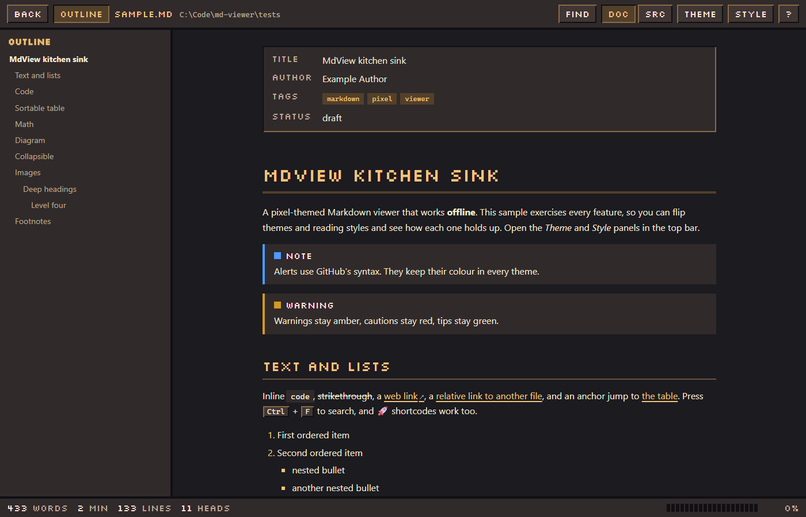
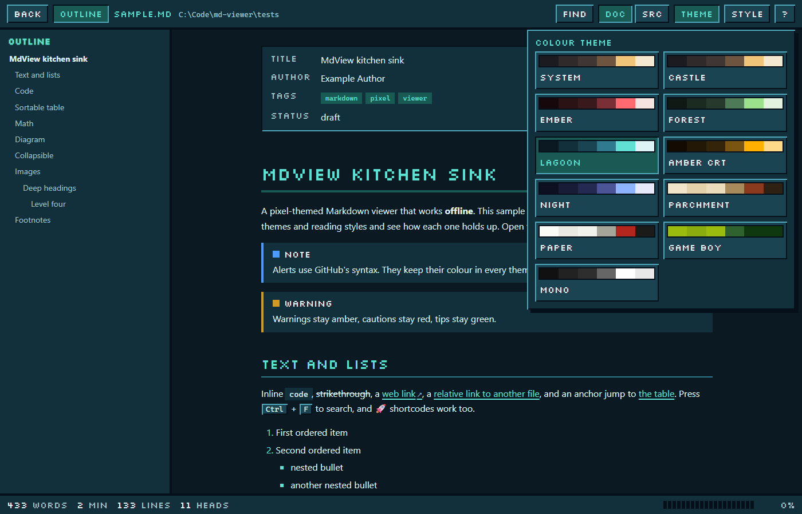
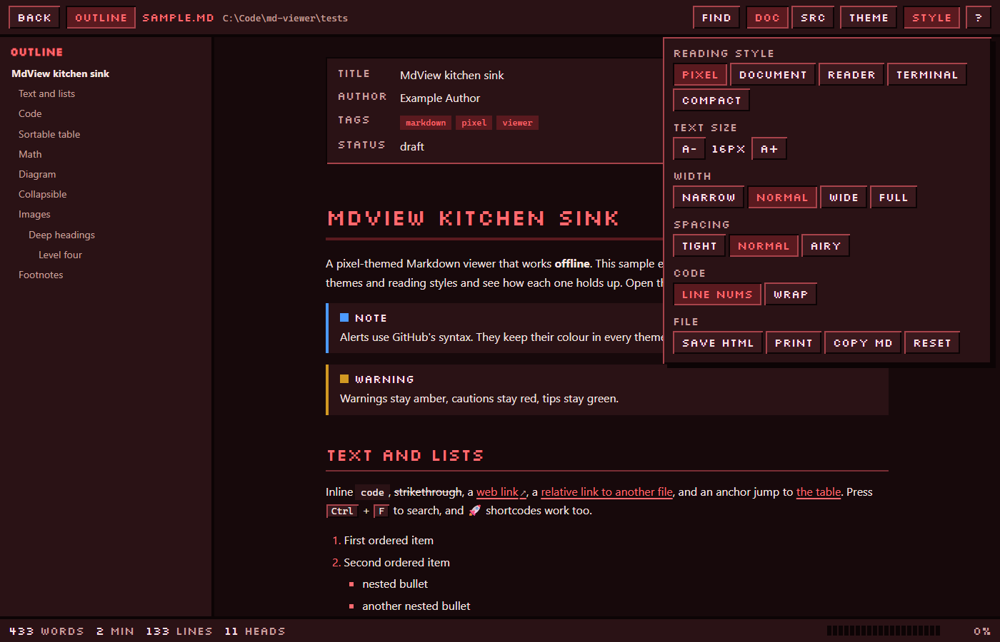
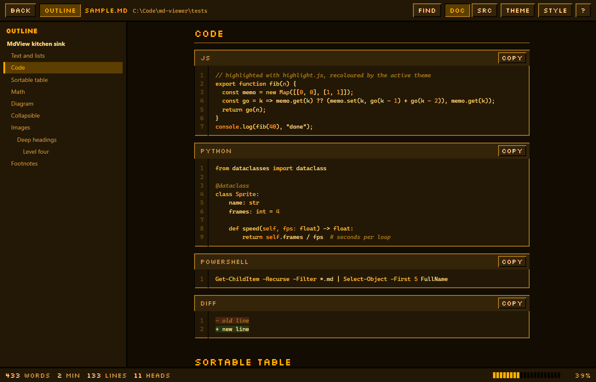
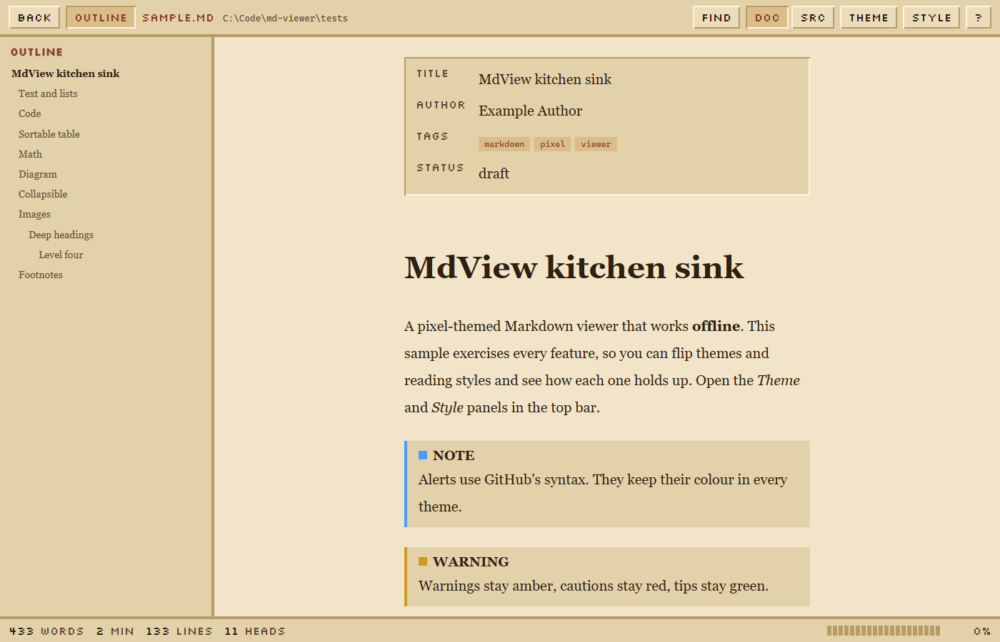
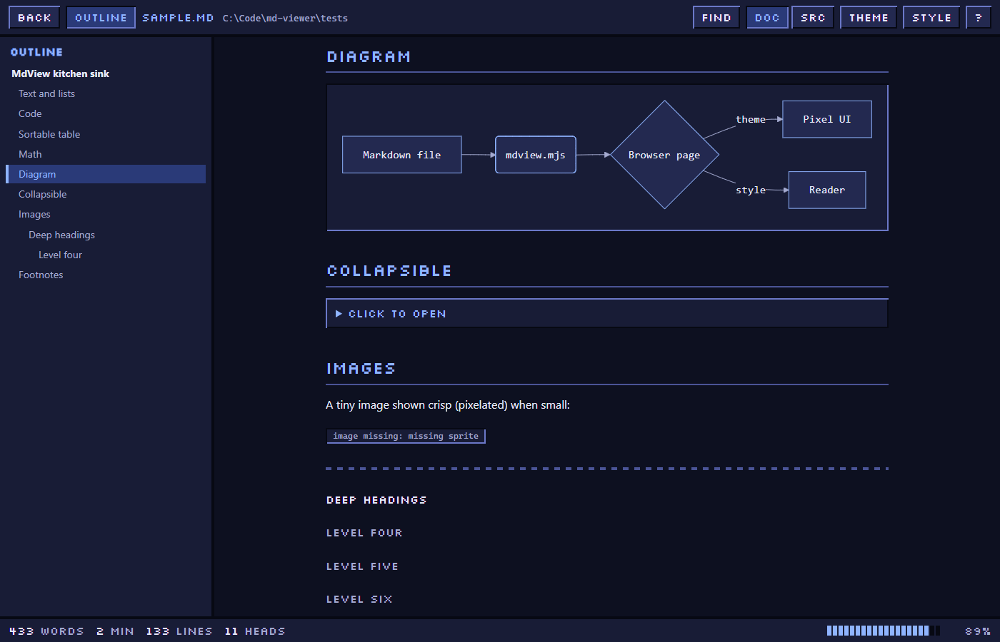
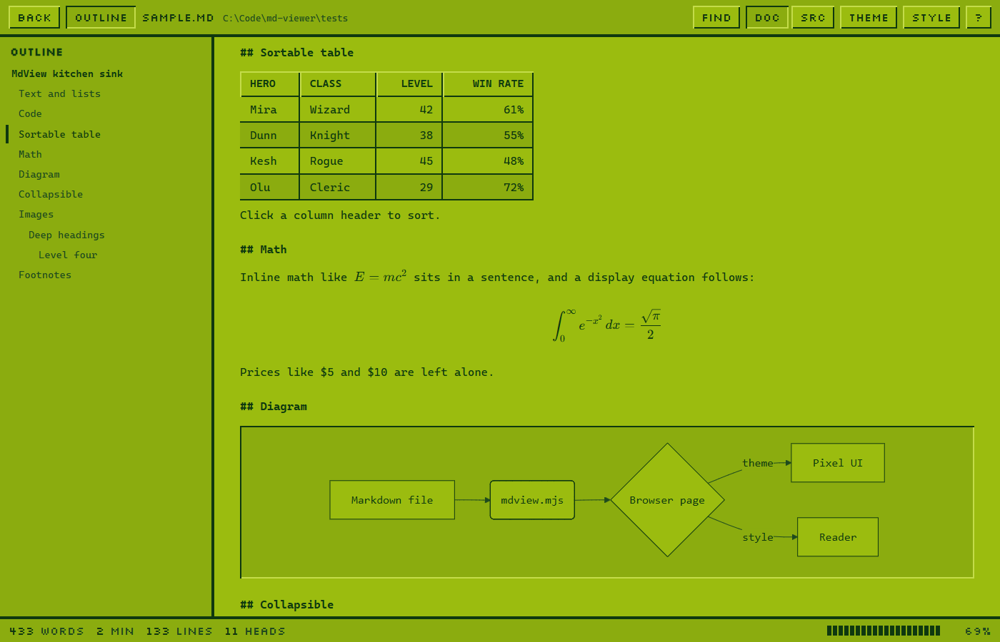
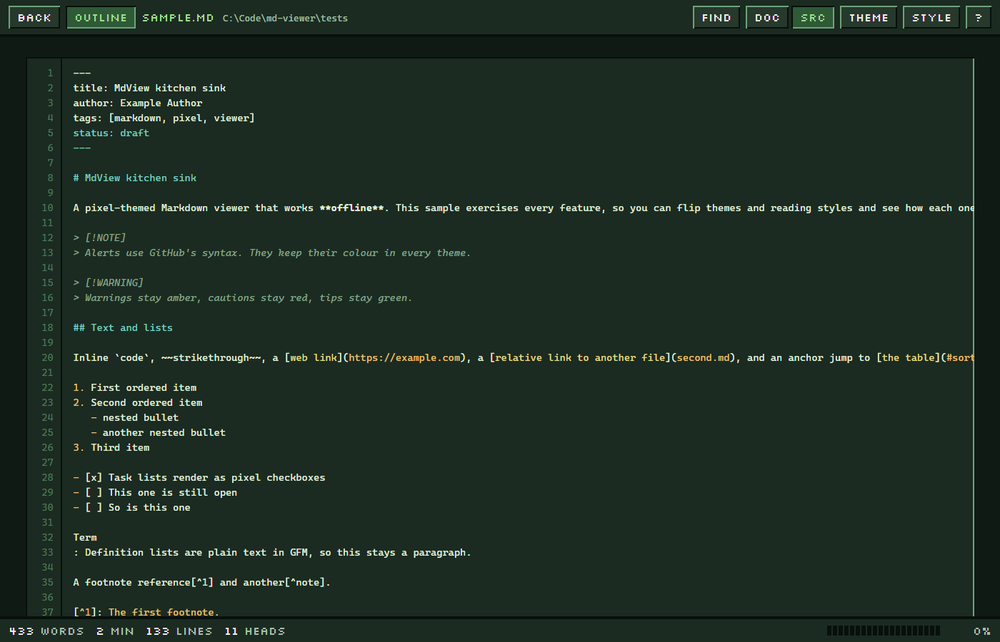

# MdView

A pixel-themed Markdown viewer that works fully offline. Double-click a `.md` file and it opens as a clean, searchable page in your browser, with ten colour themes, five reading styles, an outline, math, diagrams and live reload.



Nothing is uploaded and nothing is fetched: every library is bundled, and the page's Content-Security-Policy blocks all network requests.

## Features

- **10 themes**: Castle, Ember, Forest, Lagoon, Amber CRT, Night, Parchment, Paper, Game Boy, Mono, plus System (follows your OS light/dark). Each theme is one block of ten colours, so adding your own is a few lines in `src/themes.mjs`.
- **5 reading styles**: Pixel, Document, Reader, Terminal, Compact. Each one sets font, size, width and spacing, and you can tune size, width and spacing yourself.
- **Outline sidebar** that follows your scroll position.
- **Find** (`/` or `Ctrl+F`) with highlighted hits, next/previous and match-case, in both the rendered and source views.
- **Source view**: the raw Markdown with line numbers and highlighting.
- **Syntax highlighting** for about 50 languages (PowerShell, Python, JS/TS, Rust, Go, C#, SQL, YAML and more), recoloured by the active theme, with a Copy button and optional line numbers or wrapping.
- **Math** with KaTeX (`$E=mc^2$` and `$$ ... $$`). Prices like `$5 and $10` are left alone.
- **Diagrams** with Mermaid (flowcharts, sequence, pie, gantt and more), themed to match.
- **GitHub flavour**: tables (click a header to sort), task lists, strikethrough, autolinks, footnotes, alerts (`> [!NOTE]`, `TIP`, `IMPORTANT`, `WARNING`, `CAUTION`), `<details>`, emoji shortcodes.
- **Front matter** is shown as a tidy header card instead of raw YAML.
- **Linked Markdown files** (`[see this](other.md)`) open in the viewer, with a Back button.
- **Images**: relative paths work, small ones render crisp, click to enlarge, missing ones show a clear placeholder.
- **Zen mode**, reading progress bar, word count and reading time, scroll position remembered per file.
- **Live reload** with `--watch` while you write.
- **Export**: Save as a standalone HTML file, Print (uses a clean paper theme), or Copy the Markdown.

| | |
|---|---|
|  |  |
|  |  |
|  |  |
|  | |

## Install (Windows)

You need [Node.js](https://nodejs.org) 18 or newer.

```powershell
git clone https://github.com/taylormartins/mdview.git
cd mdview
powershell -ExecutionPolicy Bypass -File install.ps1
```

This registers MdView for the current user only (no admin, nothing machine-wide). Then make it the default: right-click any `.md` file, **Open with**, **Choose another app**, **Markdown (MdView)**, **Always**. Windows does not let a script choose your default app, so that last click is yours.

You also get a right-click **View Markdown** entry (on Windows 11, under *Show more options*). Undo everything with `uninstall.ps1`.

### Without installing

```
node mdview.mjs notes.md
```

It runs anywhere Node runs. On macOS and Linux it opens the page with `open` / `xdg-open`.

## Command line

```
mdview <file.md> [options]
  --theme <id>      castle ember forest lagoon amber night parchment paper gameboy mono system
  --style <id>      pixel document reader terminal compact
  --src             open on the Markdown source view
  --find <text>     open with the find bar searching for <text>
  --open <panel>    open a panel: theme | style | help
  --watch           re-render and reload the page when the file changes (stays running, exits after 2 hours)
  --remote-images   allow https images (off by default: the page is offline)
  --fresh           ignore the remembered scroll position
  --no-open         write the page but do not open a browser
```

Theme and style choices you make in the page are remembered. To set a default for every file, copy `mdview.config.example.json` to `mdview.config.json`:

```json
{ "theme": "castle", "style": "pixel", "remoteImages": false }
```

## Keys

| Key | Action |
|---|---|
| `/` or `F` or `Ctrl+F` | Find |
| `N` / `Shift+N` | Next / previous hit |
| `T` | Outline |
| `S` | Source / rendered |
| `[` `]` | Previous / next theme |
| `+` `-` | Text size |
| `Z` | Zen mode |
| `J` `K` | Scroll |
| `G` / `Shift+G` | Top / bottom |
| `?` | Help |

Everything is also a button in the top bar, and every popup closes when you click outside it.

## How it works

`mdview.mjs` reads the file and writes one self-contained HTML page into your temp folder (`%TEMP%\mdview`), then opens it. The page renders the Markdown in the browser with [marked](https://github.com/markedjs/marked), sanitises the result with [DOMPurify](https://github.com/cure53/DOMPurify), and highlights code with [highlight.js](https://highlightjs.org). KaTeX and Mermaid are only included in pages that use them, so ordinary documents stay small and quick to open.

Scripts, event handlers and `javascript:` links in a Markdown file are removed, and the Content-Security-Policy is `default-src 'none'` with only inline scripts and styles, local images and embedded fonts allowed.

Files in the repo:

- `mdview.mjs` command line entry
- `src/build.mjs` builds the page, `src/viewer.js` and `src/viewer.css` are the page itself, `src/themes.mjs` holds the palettes
- `mdview.vbs` hidden launcher used by the registry entries, `mdview.cmd` for terminals
- `vendor/` bundled libraries with their licences, `assets/` icon, `tools/make-icon.mjs` redraws it
- `tests/sample.md` a kitchen-sink document, `tests/smoke.mjs` a headless test

## Tests

```
npm install
npm test
```

The smoke test opens the rendered page in headless Edge or Chrome (set `MDVIEW_BROWSER` if yours is somewhere unusual) and checks find, sorting, themes, styles, source view, linked files, zen mode and that scripts in a Markdown file do not run.

## Credits and licences

MdView is MIT licensed (see `LICENSE`). Bundled: marked (MIT), DOMPurify (Apache-2.0 / MPL-2.0), highlight.js (BSD-3-Clause), KaTeX (MIT), Mermaid (MIT) and the Silkscreen font by the Silkscreen Project Authors (SIL Open Font License, `vendor/fonts/OFL-Silkscreen.txt`). See `THIRD_PARTY.md` for versions.
