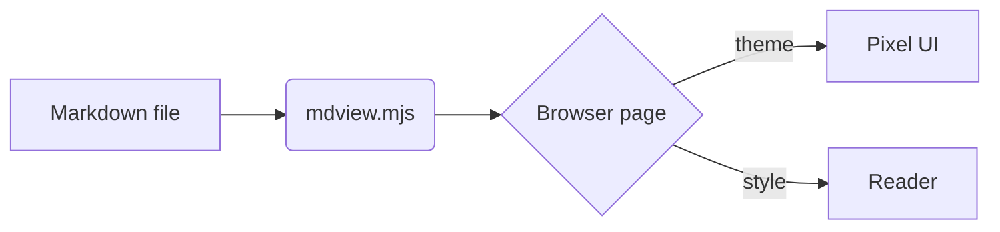

# MdView kitchen sink

A pixel-themed Markdown viewer that works **offline**. This sample exercises every feature, so you can flip themes and reading styles and see how each one holds up. Open the *Theme* and *Style* panels in the top bar.

> [!NOTE]
> Alerts use GitHub's syntax. They keep their colour in every theme.

> [!WARNING]
> Warnings stay amber, cautions stay red, tips stay green.

## Text and lists

Inline `code`, ~~strikethrough~~, a [web link](https://example.com), a [relative link to another file](second.md), and an anchor jump to [the table](#sortable-table). Press <kbd>Ctrl</kbd> + <kbd>F</kbd> to search, and :rocket: shortcodes work too.

1. First ordered item
2. Second ordered item
   - nested bullet
   - another nested bullet
3. Third item

- [x] Task lists render as pixel checkboxes
- [ ] This one is still open
- [ ] So is this one

Term
: Definition lists are plain text in GFM, so this stays a paragraph.

A footnote reference[^1] and another[^note].

[^1]: The first footnote.
[^note]: A second footnote, with `code` in it.

## Code

```js
// highlighted with highlight.js, recoloured by the active theme
export function fib(n) {
  const memo = new Map([[0, 0], [1, 1]]);
  const go = k => memo.get(k) ?? (memo.set(k, go(k - 1) + go(k - 2)), memo.get(k));
  return go(n);
}
console.log(fib(40), "done");
```

```python
from dataclasses import dataclass

@dataclass
class Sprite:
    name: str
    frames: int = 4

    def speed(self, fps: float) -> float:
        return self.frames / fps  # seconds per loop
```

```powershell
Get-ChildItem -Recurse -Filter *.md | Select-Object -First 5 FullName
```

```diff
- old line
+ new line
```

## Sortable table

| Hero | Class | Level | Win rate |
|---|---|---:|---:|
| Mira | Wizard | 42 | 61% |
| Dunn | Knight | 38 | 55% |
| Kesh | Rogue | 45 | 48% |
| Olu | Cleric | 29 | 72% |

Click a column header to sort.

## Math

Inline math like $E = mc^2$ sits in a sentence, and a display equation follows:

$$
\int_0^\infty e^{-x^2}\,dx = \frac{\sqrt{\pi}}{2}
$$

Prices like $5 and $10 are left alone.

## Diagram



## Collapsible

<details>
<summary>Click to open</summary>

Hidden content with **formatting** and a list:

- one
- two

</details>

## Images

A tiny image shown crisp (pixelated) when small:


---

### Deep headings

#### Level four

##### Level five

###### Level six

Last paragraph. Long enough to prove the progress bar at the bottom moves while scrolling through this document with the outline following along.
